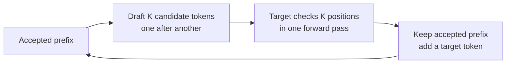

# Assisted Generation (Speculative Decoding)

- **Goal**
    - Increase generation (decoding) speed
- **Main idea**
    - A fast *draft model* proposes several tokens
    - The large *target model* checks them in one forward pass

## Why it can be faster

- **Normal decode**
    - The target model produces one token
    - Then uses that token to produce the next
    - These target calls form a serial chain
- **Assisted decode**
    - The draft model makes a short candidate chain
    - The target checks all its positions in one pass with causal attention
- **Key condition**
    - Checking several tokens must cost less than making the same number of serial target calls **plus** the draft work
    - This often depends on model size, hardware, batch size, and the number of accepted tokens.

## Single verification round

- **1. Draft:**
    - From the current accepted prefix, the draft model proposes $K$ tokens: $y_1,\ldots,y_K$
- **2. Verify:**
    - The target model evaluates the proposed continuation
    - Causal attention gives a target next-token distribution at each draft position and after the last draft token
    - The first distribution comes from the accepted prefix or its saved target logits
- **3. Accept**
    - Check proposed tokens from left to right
    - Keep the longest accepted prefix
    - Stop at the first rejection
- **4. Continue**
    - At a rejection, produce one correction token from the target rule and discard later draft tokens
    - If all $K$ tokens pass, produce one more token from the target distribution
    - Start the next round from the new accepted prefix
- **KV cache**:
    - Keep KV states for the accepted prefix
    - Remove states for rejected draft tokens before the next round

## Greedy vs sampling

- **Greedy decode**
    - Accept a draft token only if it equals the target's top token at that position
    - A mismatch uses the target's top token
    - With the same decoding settings, this gives the same greedy sequence as target-only decode
- **Sampling**
    - Matching the target's top token is not the rule
    - Let $q_i(x)$ be the draft probability and $p_i(x)$ the target probability for token $x$ at position $i$
    - Accept drafted token $y_i$ with probability $\min(1, p_i(y_i)/q_i(y_i))$
    - On rejection, sample a correction from the normalized positive part of $p_i-q_i$: $r_i(x)\propto\max(0,p_i(x)-q_i(x))$
    - If every draft token passes, sample one extra token from the target's distribution after the draft

- **Token IDs:** The basic two-model method uses a shared vocabulary. Other assisted methods need explicit handling when tokenizers differ.

## Speed control

- **Acceptance**
    - More accepted draft tokens mean more output tokens per target call
    - A draft model must be fast *and* predict the target well
- **Draft length $K$**
    - A longer draft can save target calls
    - It also adds serial draft work and wastes more work after an early rejection
- **Verification cost**
    - A target check processes several query positions
    - It is more work than a one-token target decode
- **Memory and load**
    - A separate draft model needs memory and its own KV cache
    - Large batches can reduce the benefit of speculation

## Drafting techniques

- **Small model**
    - Use a separate, faster model
    - This is the classic method above
- **Prompt lookup**
    - Copy a likely continuation from repeated text in the prompt or output
    - This needs no draft model, but depends on repetition
- **Medusa**
    - Add lightweight heads to an existing target model
    - Each head predicts a different future token from the same hidden state
    - Combine likely tokens into candidate paths
    - Use tree attention to check several paths in one target pass
- **Multi-token prediction (MTP)**
    - Train the model to predict several future tokens at each position　(often with separate prediction heads)
    - Use these predictions as drafts at inference time
- **EAGLE**
    - Train a small module to predict the target model's next internal features, then use the target's output head to propose tokens
    - Feed the sampled token back into the module
    - The next feature depends on which token was actually chosen
- **Correctness rule**
    - These methods change how candidates are made
    - Target verification and its acceptance rule determine whether decoding keeps the target distribution

## Sources

- [Modular: Speculative decoding](https://handbook.modular.com/inference-optimization/speculative-decoding/)
- [Leviathan, Kalman, and Matias: Fast Inference from Transformers via Speculative Decoding](https://proceedings.mlr.press/v202/leviathan23a.html)
- [Chen et al.: Accelerating Large Language Model Decoding with Speculative Sampling](https://arxiv.org/abs/2302.01318)
- [Cai et al.: Medusa](https://arxiv.org/abs/2401.10774)
- [Gloeckle et al.: Better & Faster Large Language Models via Multi-token Prediction](https://arxiv.org/abs/2404.19737)
- [Li et al.: EAGLE](https://arxiv.org/abs/2401.15077)
