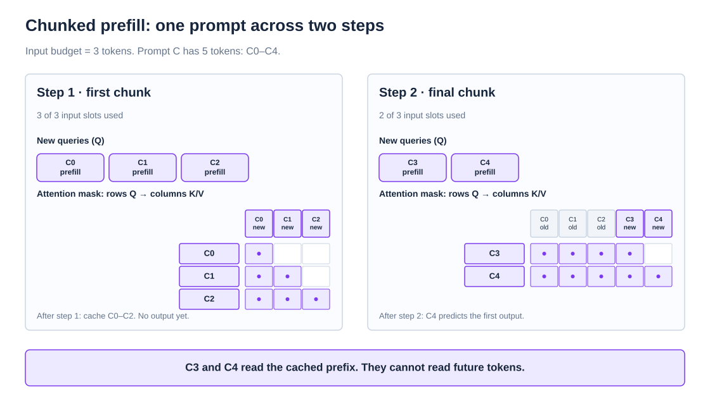
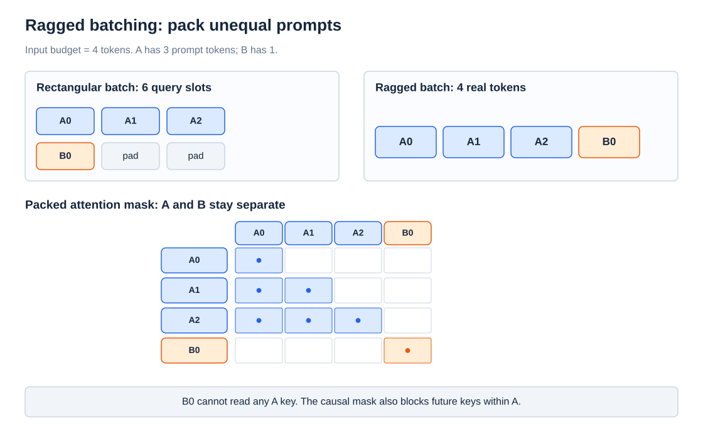
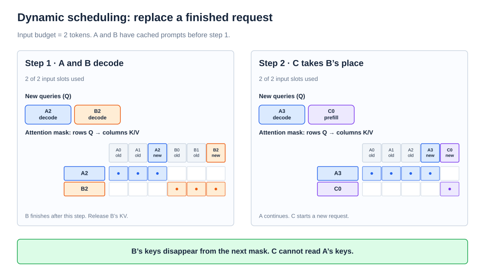
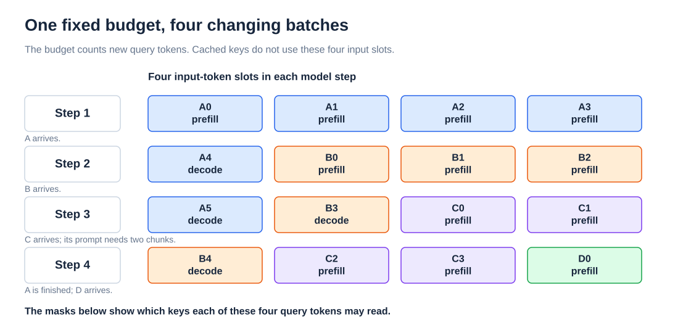
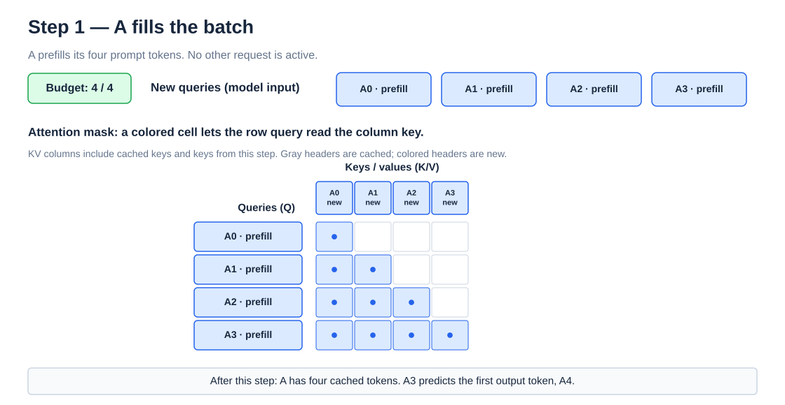
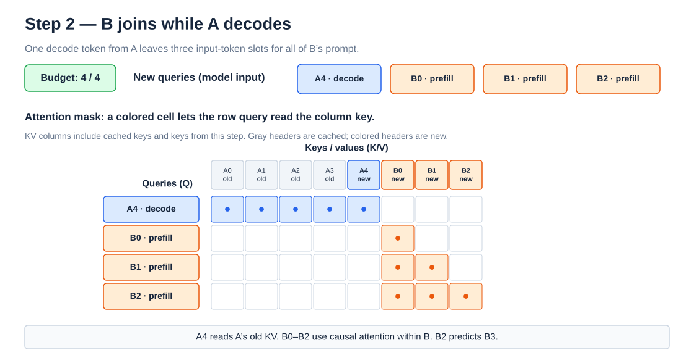
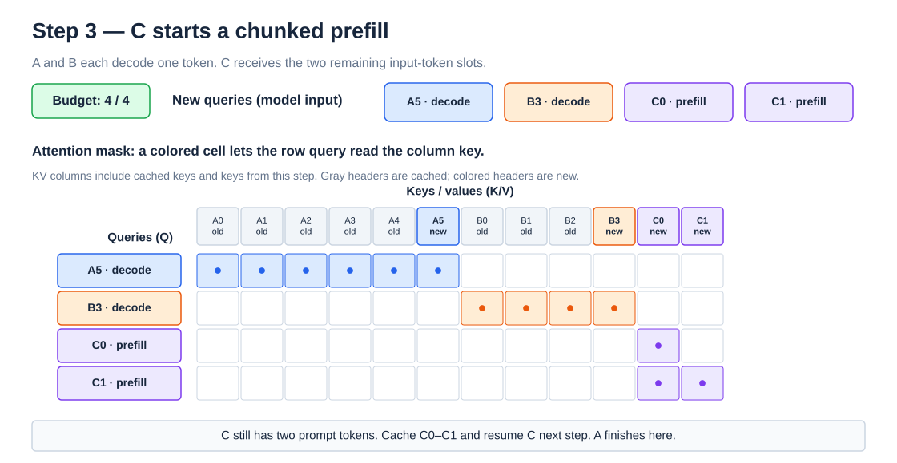
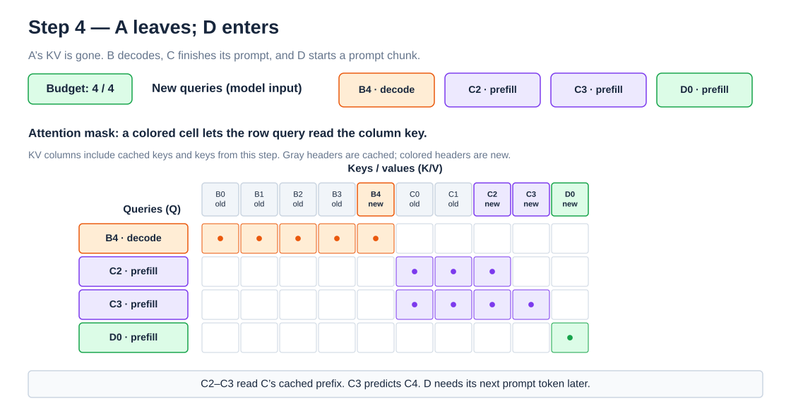

# Continuous Batching

- **Goal**
    - optimization for throughput
    - serve requests that arrive and finish at different times.
- **Budget rule**
    - each model step has a limit on *new input tokens*
- **Read the masks**
    - rows are new queries ($Q$)
    - columns are keys and values ($K/V$)
    - a colored cell means that the row token can use the column token
    - a white cell blocks attention.

## Chunked Prefill

- **Request stages**
    - **Prefill**
        - process prompt tokens
        - build their KV cache
        - last prompt token gives the first output prediction
    - **Decode**
        - process one new input token
        - use the stored KV cache
        - predict the next output token
- **Problem**
    - a long prompt can take a long model step
    - active decode requests must wait for that step to finish
- **Rule**
    - split the prompt into smaller groups of *new query tokens*
    - keep the request's KV after each group
- **Small example:** the input budget is three tokens, but `C`'s prompt has five tokens, `C0–C4`.
    - Step 1 sends `C0–C2`. The mask is causal within this first chunk. Save their KV.
    - Step 2 sends `C3–C4`. These queries read cached `C0–C2` and earlier tokens in the new chunk.
    - Only step 2 reaches the end of the prompt. `C4` can then predict the first output token.



- **Why it helps**
    - frees input slots for other decode / prefill tasks
    - limits how much prefill work runs
- **Tradeoff**
    - smaller chunks need more model calls / more reads from the KV cache
    - can increase time to first token for the new request
    - the best chunk size depends on load and latency targets.


## Ragged batching

- **Problem**
    - a rectangular batch needs every request to have the same query length
    - short requests get padding slots
- **Rule**
    - place only real query tokens in one packed array
    - keep each token's request ID and position
- **Small example**
    - `A` has three prompt tokens and `B` has one
    - A rectangular batch has six query slots, including two padding slots
    - A ragged batch has four real tokens
    - A four-slot rectangular input cannot hold both requests, but a four-slot packed input can.
- **Mask**
    - `A` queries read only `A`'s causal prefix
    - `B0` reads only `B0`
    - No token reads a different request's KV



- **Why it helps**
    - the packed input avoids query padding
    - ability to mix one-token decodes with longer prefill chunks

## Dynamic scheduling

- **Problem**
    - a fixed batch can keep an empty slot after one request ends while another request waits
- **Rule**
    - after each model step, remove finished requests and admit waiting ones when capacity permits
- **Small example**
    - The input budget is two tokens
    - `A` and `B` already have cached prompts
    - Step 1 decodes `A2` and `B2`. `B` finishes, so the scheduler can release `B`'s KV
    - Step 2 decodes `A3` and starts `C` with `C0`. `A` continues; `C` takes `B`'s place.
    - The second mask has no `B` columns. It has a new `C` column. `C` cannot read `A`'s KV.



- **Why it helps**
    - new requests can start before all old requests finish
    - the server can keep its input slots busy
- **Tradeoff**
    - the scheduler must check both the input-token budget and KV memory
    - a new prefill can delay active decodes if it makes a model step too long

## Continuous batching: bringing evetyhing together

- Keep the three rules above
    - split prompts
    - pack real tokens
    - change batch membership after each step
- Use them in one four-step example with a fixed four-token input budget.

### One budget, four model steps

- Four requests arrive over time
    - `A`: four prompt tokens, then three output tokens.
    - `B`: three prompt tokens, then three output tokens.
    - `C`: four prompt tokens. Its prefill needs two chunks.
    - `D`: two prompt tokens. Its prefill starts in step 4.
- Rules
    - the scheduler forms a new batch at each step
    - it gives active decodes one input token each
    - then fills free slots with prompt tokens

- Note
    - The example shows one possible policy
    - A real scheduler also checks KV memory, request limits, and latency targets



### Stp-by-step









### Pseudocode algorithm

- `TOKEN_BUDGET` limits **new query tokens** in one model step
- This example gives active decodes priority, then uses free slots for prompt chunks
- Other scheduling policies are possible
- `pack` adds request IDs and positions
- The mask rule keeps requests separate and enforces causal attention

```python
while server_is_running:
    waiting.add(new_arrivals())
    slots = TOKEN_BUDGET
    work = []  # (request, phase, new_tokens)

    for request in active_decodes():
        if slots == 0:
            break
        work.append((request, "decode", [request.pending_token]))
        slots -= 1

    for request in eligible_prefills(active, waiting):
        if slots == 0:
            break
        if not kv_memory_available(request):
            continue
        chunk = request.take_prompt_tokens(at_most=slots)
        work.append((request, "prefill", chunk))
        slots -= len(chunk)
        active.add(request)
        waiting.discard(request)

    if not work:
        wait_for_arrival_or_capacity()
        continue

    queries = pack_without_padding(work)  # keep request ID and position
    def can_attend(q, k):
        return q.request_id == k.request_id and k.position <= q.position

    logits, new_kv = model_step(queries, old_kv=cache, mask=can_attend)

    for request, phase, chunk in work:
        cache[request].append(new_kv[request])
        if phase == "prefill":
            if request.prompt_remaining > 0:
                continue  # another prompt chunk is needed; no output yet
            request.phase = "decode"
        token = sample(logits.last_for(request))
        request.pending_token = token  # input for its next decode step
        emit(request, token)
        if token == EOS or request.output_limit_reached():
            active.remove(request)
            cache.release(request)
```

## Sources

- [Hugging Face: Continuous batching from first principles](https://huggingface.co/blog/continuous_batching)
- [vLLM: Chunked prefill and performance tuning](https://docs.vllm.ai/en/latest/configuration/optimization/)
- [Sarathi-Serve: chunked prefill and stall-free scheduling](https://arxiv.org/abs/2403.02310)
