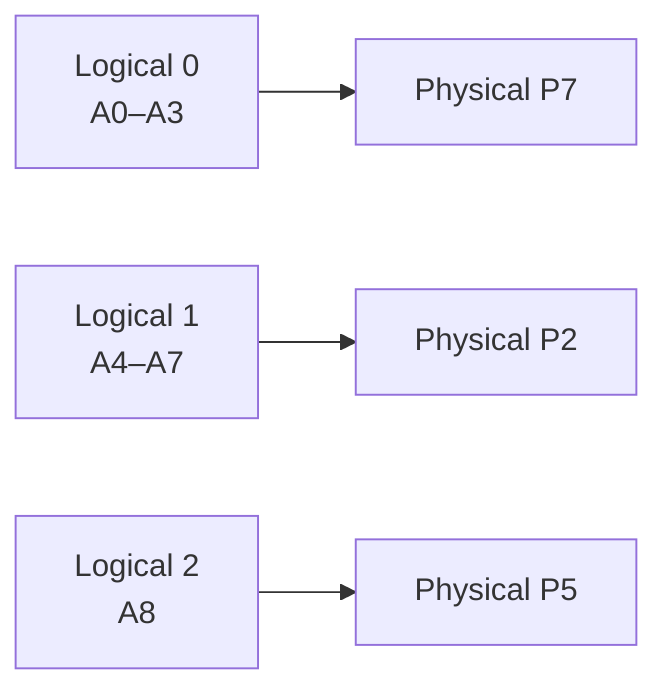

# PagedAttention

- **Goal**
    - Fit more active sequences in GPU memory by using the KV cache efficiently
- **Main idea**
    - Split each sequence's KV cache into fixed-size blocks
    - Store the blocks anywhere in a GPU memory pool
- **Lookup**
    - A block table maps the sequence's logical block order to physical blocks
    - The attention kernel follows this map to read the right keys and values

## Main Idea

- **KV cache**
    - Each token adds keys and values that later tokens
    - The cache grows with the sequence
- **Contiguous allocation**
    - A server reserves fixed amount of space for a sequence's maximum length (even if generation stops early)
    - Reservation sizes can leave unusable space in GPU memory
- **Paged allocation**
    - The server allocates another fixed-size block only when the sequence needs it
    - Its physical blocks do not have to sit next to each other
    - Only the last block of a sequence can have unused token slots

## Lookup

- **Logical block:** a group of consecutive token positions in one sequence
- **Physical block:** a place in the GPU pool that holds one logical block's KV data
- **Block table:** records the assigned physical block for each logical block.
- **Attention**
    - The kernel uses the table to find the keys and values for earlier token positions
    - Token order stays logical even when physical blocks are scattered

## Example

Blocks hold four tokens. `A` has six cached tokens, `A0–A5`

| Logical block | Tokens | Physical block | Filled slots |
| --- | --- | --- | --- |
| 0 | `A0–A3` | `P7` | 4 of 4 |
| 1 | `A4–A5` | `P2` | 2 of 4 |

- The next two cached tokens, `A6–A7`, fill `P2`
- When `A8` enters the cache, the server assigns logical block 2 to a free block, such as `P5`
- The table is now `0 → P7`, `1 → P2`, `2 → P5`. The kernel still reads `A0–A8` in token order

- Arrows are block-table entries
- `P7`, `P2`, and `P5` show that the physical blocks can be out of order.

## Shared prefix

- **Same prefix**
    - Two continuations can map their common logical blocks to the same physical blocks
    - This avoids a second copy of those KV states
- **Safe sharing**
    - The prefix must have the same tokens in the same positions under compatible model and cache settings
    - Matching token text alone does not guarantee matching KV states

## Tradeoffs

- **Block size**
    - Smaller blocks waste fewer last-block slots
    - Larger blocks can make KV reads more efficient, but can waste more slots and reduce sharing opportunities
- **Indirection**
    - The kernel must read a block table and handle scattered blocks
    - This adds bookkeeping and can cost performance compared with a simple contiguous cache
- **Throughput**
    - Better cache use can let the server batch more sequences
    - The gain depends on: sequence lengths, block size, workload

## Sources

- [Kwon et al., *Efficient Memory Management for Large Language Model Serving with PagedAttention* (2023)](https://arxiv.org/html/2309.06180)
- [vLLM, *Paged Attention* kernel documentation](https://docs.vllm.ai/en/stable/design/paged_attention/)
